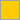
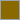
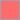
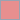
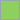
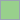

# Custom themes

Four Pokémon palettes for development tools: Dark, Dark Pastel, Light, and Light Pastel. The VS Code themes in `vscode/` are the source palettes. Other applications expose different styling capabilities, so each tool adapts the same visual roles.

Dark and Dark Pastel share navy surfaces. Light and Light Pastel share white surfaces. Pastel variants soften accent, status, and text colors and keep the surfaces of their pair. These are the source role colors from the VS Code themes:

| Role | Dark | Dark Pastel | Light | Light Pastel |
|---|---|---|---|---|
| Surface |  `#080C18` |  `#080C18` |  `#FFFFFF` |  `#FFFFFF` |
| Text |  `#F5F7FF` |  `#E4EAF6` |  `#1F2937` |  `#314050` |
| Accent |  `#FFCB05` |  `#F5D76E` |  `#3B4CCA` |  `#5563D8` |
| Warning |  `#FFCB05` |  `#F5D76E` |  `#8A6A00` |  `#8A6A00` |
| Error |  `#FF6B6B` |  `#E88F8F` |  `#CC0000` |  `#C44747` |
| Success |  `#8ED060` |  `#98D08C` |  `#2F7A28` |  `#2F7A28` |

| Tool | Installation and development |
|---|---|
| [VS Code](vscode/) | Four standalone extensions. Light themes use `uiTheme` `vs` |
| [Vim](vim/) | Four standalone colorschemes. Light schemes set `background=light` |
| [Neovim](neovim/) | Four standalone colorschemes with diagnostics |
| [GNOME Terminal](terminal/) | Four 16-color profiles |
| [Tern](stencil_tern/) | Four CSS themes for terminal and interface |
| [DBeaver](dbeaver/) | Four Linux workbench and SQL editor themes |
| [Ubuntu GNOME](linux/) | Four GTK and GNOME Shell themes. Dark imports `Yaru-dark`; light imports `Yaru` |
| [Airflow](airflow/) | Four palettes: a 2.10.5 plugin and a 3.2+ theme configuration |
| [Superset](superset/) | Four Superset 6 theme JSON files |

Each directory contains a README. Generated VSIX packages are not tracked. Changes to an Airflow configuration affect the entire server; see its README before applying.

---
> **Disclaimer:** This is an unofficial, fan-made color theme created purely for personal and educational use. It is not affiliated with, endorsed, sponsored, or specifically approved by Nintendo, Creatures Inc., GAME FREAK inc., or The Pokémon Company. All trademarks and copyrights belong to their respective owners.
